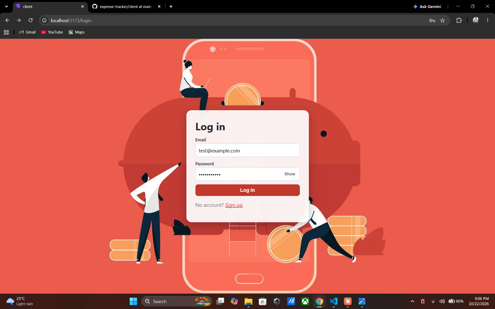
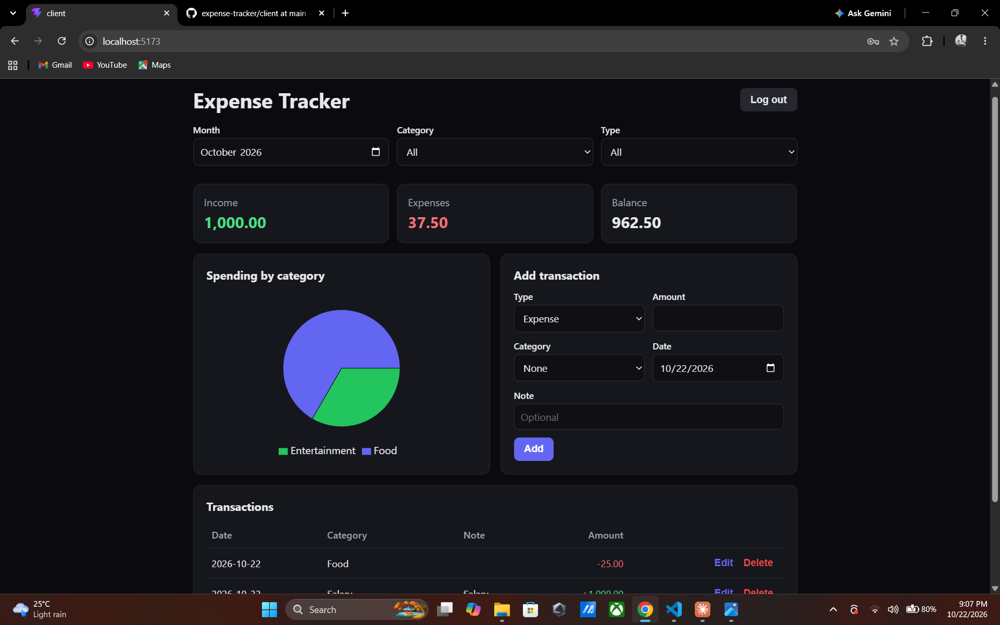

# Expense Tracker

A full-stack personal finance app for tracking income and expenses. Users create an account, log transactions by category, and see monthly totals and a spending breakdown on a dashboard.

> This project runs locally. See [Running it locally](#running-it-locally) for setup steps.

## Screenshots

| Login | Dashboard |
|---|---|
|  |  |


## Features

- Register and log in with email and password (JWT authentication)
- Add, edit and delete income and expense transactions
- Default categories created for every new account
- Filter transactions by month, category and type
- Monthly summary cards: income, expenses and balance
- Pie chart of spending by category
- Protected routes on the frontend and token-checked endpoints on the backend
- Responsive layout with a dark dashboard theme

## Tech stack

| Layer | Technology |
|---|---|
| Frontend | React (Vite), React Router, Recharts, plain CSS |
| Backend | Node.js, Express 5 |
| Database | PostgreSQL (hosted on Neon) |
| Auth | JSON Web Tokens, bcrypt password hashing |
| Validation | Zod |

## How it works

```
React app (browser)  ->  Express REST API  ->  PostgreSQL
  UI and charts           auth, validation,      users, categories,
                          SQL queries            transactions
```

- Passwords are hashed with bcrypt and never stored in plain text.
- The API issues a JWT on login. The frontend sends it in the `Authorization` header, and middleware verifies it on every protected route.
- Every query is scoped to the logged-in user's id, so one user can never read or change another user's data.
- Request bodies are validated with Zod before they reach the database, and all SQL uses parameterised queries.
- Monthly totals and the category breakdown are calculated in SQL (`SUM`, `GROUP BY`, `FILTER`) instead of in the browser.

## API endpoints

| Method | Endpoint | Description | Auth |
|---|---|---|---|
| POST | `/auth/register` | Create an account, returns a token | No |
| POST | `/auth/login` | Log in, returns a token | No |
| GET | `/categories` | List the user's categories | Yes |
| GET | `/transactions` | List transactions (`?month=YYYY-MM&category_id=&type=`) | Yes |
| POST | `/transactions` | Create a transaction | Yes |
| PUT | `/transactions/:id` | Update a transaction | Yes |
| DELETE | `/transactions/:id` | Delete a transaction | Yes |
| GET | `/summary/monthly` | Income, expenses and balance (`?month=YYYY-MM`) | Yes |
| GET | `/summary/by-category` | Expense totals per category (`?month=YYYY-MM`) | Yes |

Protected endpoints expect an `Authorization: Bearer <token>` header.

## Database schema

Three tables: `users`, `categories` and `transactions`, linked by foreign keys, with an index on `transactions (user_id, date)`. The full SQL is in [`server/schema.sql`](server/schema.sql).

## Project structure

```
expense-tracker/
├── client/                 React frontend
│   └── src/
│       ├── api.js          fetch wrapper that attaches the JWT
│       ├── AuthContext.jsx login state
│       ├── pages/          AuthPage, Dashboard
│       └── components/     TransactionForm
├── docs/                   README screenshots
└── server/                 Express API
    ├── schema.sql
    ├── .env.example
    └── src/
        ├── index.js
        ├── db.js
        ├── middleware/     auth (JWT check)
        └── routes/         auth, categories, transactions, summary
```

## Running it locally

**Requirements:** Node.js 20 or newer and a PostgreSQL database (a free [Neon](https://neon.tech) project works well).

### 1. Clone the repo

```bash
git clone https://github.com/chamathcj/expense-tracker.git
cd expense-tracker
```

### 2. Set up the backend

```bash
cd server
npm install
```

Copy `.env.example` to `.env` and fill in your own values (on Windows PowerShell, use `copy .env.example .env`):

```bash
cp .env.example .env
```

| Variable | What to put |
|---|---|
| `PORT` | Port for the API (default `5000`) |
| `DATABASE_URL` | Your PostgreSQL connection string |
| `JWT_SECRET` | A long random string, for example from `node -e "console.log(require('crypto').randomBytes(32).toString('hex'))"` |

Create the tables by running the SQL in `schema.sql` against your database (for Neon, paste it into the SQL Editor). Then start the API:

```bash
npm run dev
```

The API runs at `http://localhost:5000`. You can check it at `http://localhost:5000/health`.

### 3. Set up the frontend

In a second terminal, from the project root:

```bash
cd client
npm install
npm run dev
```

Open `http://localhost:5173`, register an account and start adding transactions. If your API runs somewhere other than `http://localhost:5000`, set `VITE_API_URL` in `client/.env`.

## What I'd improve next

- Automated tests for the API (Jest and Supertest)
- Rate limiting on the login route and stricter CORS settings
- Recurring transactions and monthly category budgets
- CSV export
- Docker Compose for one-command setup
- Deploy the app (API on Render, frontend on Vercel)

## Author

Chamath Jayasundara
[GitHub](https://github.com/chamathcj)
